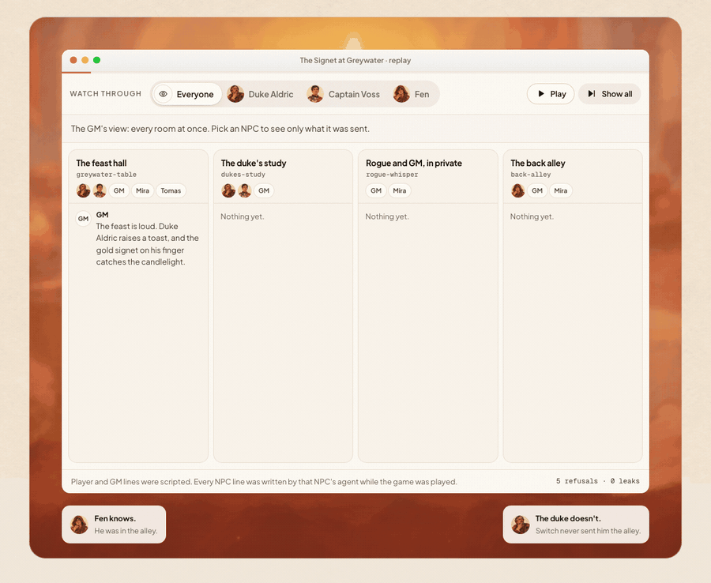

# Tablefolk

AI NPCs for your tabletop game that only know what was said in front of them.

[Switch](https://github.com/sandbox-quantum/switch) puts people and AI agents in the same chat rooms (Mattermost, Slack, Discord and others), each agent with its own identity. In Tablefolk every NPC is its own Switch agent, with its own key and its own connection, and Switch only delivers it the rooms it sits in. The secrets aren't kept by telling a model to stay quiet. When the rogue sells the duke's ring in the back alley, the duke's agent never receives that message, and if it asks Switch for the alley's history it gets a 403.



**Live replay:** https://tablefolk-seven.vercel.app (a recorded game; pick any NPC to see exactly what it was told)

## Try it in 30 seconds

Open the live replay. It starts in Duke Aldric's view: the two rooms he isn't in are locked, and each lock shows the answer Switch gave when he tried to read them. Then click **Fen**: he knows about the ring, and the duke and the captain don't. At the end of the scene they accuse Mira from what they saw at the table.

## Run a table on your own Switch server

You need Switch Console with its local server and the bundled Mattermost, Node 20+, and either an Anthropic API key or Ollama.

```bash
git clone <this repo> && cd tablefolk
echo "SWITCH_URL=http://127.0.0.1:<bridge port>" >> .env
echo "SWITCH_REGISTRATION_TOKEN=<registration key>" >> .env
echo "ANTHROPIC_API_KEY=<key>" >> .env      # or leave it out to use Ollama (gemma4:e2b)
npm run table -- --gm sam --rogue rowan --players rowan,juno
```

`npm run table` registers the Keeper and the three NPCs as Switch agents, runs the Switch room template to create the four rooms on Mattermost as one linked group with the right people and agents in each, and runs every agent. Then play in Mattermost:

- Talk to an NPC by name: `Duke Aldric, may I see your ring?`
- `roll 1d20+3` rolls dice. `hp Mira -4` tracks hit points. The Keeper does both in code.
- `aside fen @rowan` has Switch open a new private room with Fen, Rowan and the GM, right then.

Without people around, `npm run demo` plays a short scripted scene with stand-in players on your server and records it. `npm run export recordings/<file>.jsonl` turns a recording into `viewer/session.json` for the replay page.

## How it works

| Room | Who is in it |
| --- | --- |
| greywater-table | GM, players, Keeper, Duke Aldric, Captain Voss |
| dukes-study | GM, Keeper, Duke Aldric, Captain Voss |
| rogue-whisper | GM, the rogue, Keeper |
| back-alley | GM, the rogue, Keeper, Fen |

- `src/switch-client.js` speaks the Switch agent protocol: an SSE stream down, HTTP up, a heartbeat every 2 seconds. Each NPC opens one connection per room it belongs to.
- `src/npc.js` is the NPC. Its memory is the list of messages its own connections delivered. That list is all its prompt contains, so it can't leak a room it was never sent. When it starts, it asks Switch for every room it is not in and records the refusal.
- `src/keeper.js` is an agent with no model. Dice, hit points and side rooms are rules, so they run in code.
- `src/recorder.js` writes one line per delivery: which agent received which message, in which room. The replay page reads this, so "through the duke's eyes" is what the duke's agent was actually sent.
- `templates/greywater.template.yaml` is the Switch room template `npm run table` runs: four rooms in one linked group, with the existing NPC agents seated in them. Without people (`npm run demo`, `npm test`) the rooms are agent-only and made one by one.

## Tests

`npm test` runs against a real Switch server. Stand-in player agents talk in agent-only rooms, and the test checks that:

- Switch refuses each NPC every room it isn't in (it asks, and expects a 403),
- dice rolls land in the room,
- the duke answers at the table and Fen answers in the alley,
- the alley message never reaches the duke or the captain.

How fast an NPC answers depends on the model. In the e2e test, with a local gemma4 model, replies took about 3 to 4.5 seconds. In the recorded replay, which used a hosted model called through a command-line tool, they took about 6.5 to 9 seconds.

## Limits

- One campaign so far: "The Signet at Greywater".
- NPCs answer when someone names them. They don't speak up on their own, and they don't banter with each other (that's one constant in `src/npc.js`).
- Small local models write weaker lines than a hosted model. The recorded replay used a hosted model.
- Player and GM lines in the replay are scripted (`npm run demo`). Every NPC line was written live by that NPC's agent.
- Switch posts a short "tag me" greeting when an agent joins a chat room. Tablefolk keeps it out of NPC memory, but the players will see it once.
